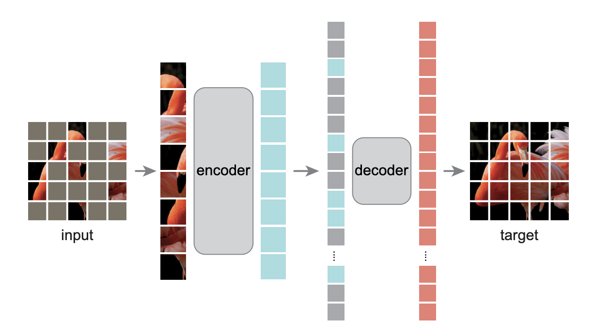

# MY NOTES

## Things I have learned to understand SatMAE

### General structure

- A Vision Transformer (ViT) is something that processes an image in patches and learns relationships between them. ViT is the thing that turns the original image into numerical features and it does this by observing the image in patches and learning how they relate to eachother.

- In a Masked Autoencoder (MAE), the ViT is the encoder.

- MAE is the training process that teaches ViT to do its job well. It uses an encoder and decoder to do this. More on the structure below.

- SatMAE is MAE adapted for pretraining specifically on satellite imagery. This is what I will use as my starting point.

### How does MAE work?

Consider this diagram from the paper that introduces MAE ([MAE paper](https://arxiv.org/abs/2111.06377))

- The encoder is given the unmasked patches of the image. It observes them and turns them into numerical features by learning how they relate to eachother.

- The numerical features are passed to the decoder.

- The decoder also receives the mask tokens and the associated postional embeddings. These tell it the location of the masked patches.

- The decoder builds latent features for the masked patches and turns these into pixels which fill in the gaps.

- The predictions of the masked patches are compared to the real image, a loss is calculated and the weights of the encoder and decoder are updated using backpropagation and gradient descent. This is how the MAE learns.

- Backpropagation: calculates how a small change to weights would impact loss and works backwards, using the chain rule to calculate the loss gradient wrt each weight. The optimiser (gradient descent) then uses these gradients to try to find the lowest loss.

## Experiments that have already been done

These are experiments that I found that are relevnat to adapting SatMAE to the EuroSAT dataset.

- [Original SatMAE paper](https://arxiv.org/pdf/2207.08051): they tested adding a classification head to the end of SatMAE and training this, along with fine-tuning the SatMAE weights to predict EuroSAT RGB land-cover/use classes. They acheive 95.74% top-1 accuracy.

- In this paper they also do the same on a different dataset: fMoW RGB. On this dataset they also test freezing the backbone of SatMAE (ie: not finetuning the weights), and just training a classification head.

- [SMARTIES](https://arxiv.org/abs/2506.19585): in this paper they do the closest thing to what I plan on doing. They freeze the backbone of SatMAE, keeping the original weights fixed and train a classification head to predict classes in EuroSAT. They acheive 93% top-1 accuracy. Look for table 2 in section 4.3 for the details.

- Clarifying details of above results: "95.74% was for RGB-only EuroSAT with full fine-tuning, and 93.0% was for a linear head on frozen RGB SatMAE ViT-Large features, reported as a comparison in SMARTIES Table 2."

## What I will do

- Feed complete EuroSAT RGB tiles (satellite images) into the frozen SatMAE encoder

- These extract one embedding (latent features) per tile

- Then I will train a 10-class linear classifier on those embeddings using the EuroSAT labels

- I am freezing the backbone to make the experiment cheaper to run. It makes the research question clear: are the features learned from reconstructing satellite images immediately useful for classifiying EuroSAT data?